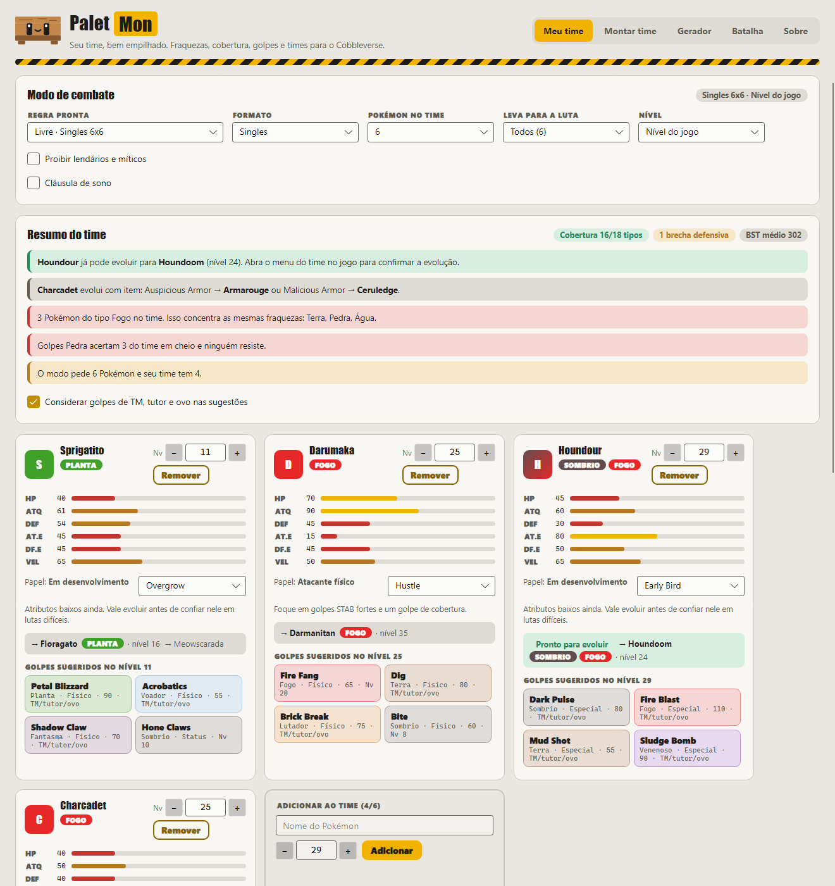

# Palet Mon

Seu time, bem empilhado. Um estrategista de time para o **Cobbleverse**, o modpack de Pokémon para Minecraft.



## Baixar

**[Baixar o instalador para Windows](https://github.com/carlosgguilherme/palet-mon/releases/latest/download/Palet-Mon-Instalador.exe)**

Abra o arquivo e pronto. Não precisa de permissão de administrador: o app abre sozinho e cria atalhos na Área de Trabalho e no Menu Iniciar.

O código-fonte de cada versão fica separado na página de [releases](https://github.com/carlosgguilherme/palet-mon/releases), em **Source code**.

O Windows pode mostrar o aviso "O Windows protegeu o computador" porque o instalador ainda não tem certificado digital. Clique em **Mais informações** e depois em **Executar assim mesmo**.

## Atualizações

O app procura novidades ao abrir e avisa no topo da janela. Para procurar na hora, abra a aba **Sobre** e clique em **Verificar atualizações**. Ele baixa, instala e reinicia sozinho, e seu time continua salvo.

## O que ele faz

- **Meu time:** fraquezas, cobertura de ataque, golpes sugeridos e evoluções.
- **Montar time:** você escolhe seus Pokémon e o app completa o resto em volta deles.
- **Gerador:** times aleatórios, com sinergia, competitivos, de clima, monotipo e mais.
- **Batalha:** quem mandar contra um tipo ou um Pokémon adversário.
- **Modo de combate:** Singles, Duplas, Triplas, 3 de 6, Nv 50, Little Cup e regras personalizadas.

## Para desenvolver

Precisa do [SDK do .NET 8](https://dotnet.microsoft.com/download/dotnet/8.0).

```powershell
dotnet tool restore
dotnet run --project PaletMon
```

- `PaletMon/Logic`: tipos, golpes, gerador, modos de combate e atualizador.
- `PaletMon/UI`: telas, feitas com Avalonia.
- `PaletMon/Assets/dex.json`: dados da PokéAPI.
- `PaletMon.Snap`: tira fotos das telas sem abrir janela.

### Lançar uma versão nova

Crie uma tag. O GitHub Actions gera o instalador, a atualização e a release:

```powershell
git tag v2.2.0
git push origin v2.2.0
```

Quem já tem o app instalado recebe a versão nova sozinho. Para gerar o instalador no seu PC, sem publicar, rode `.\publicar.ps1 -Versao 2.2.0`.

### Assinatura digital

Com um certificado de assinatura de código instalado no Windows, rode `.\publicar.ps1 -Versao 2.2.0 -Certificado <impressão digital>`. Para assinar pelo GitHub Actions, adicione os parâmetros de assinatura ao passo `vpk pack` do workflow.

## Aviso

Palet Mon é um projeto de fã, sem ligação com Nintendo, The Pokémon Company ou Cobblemon. Os dados vêm da [PokéAPI](https://pokeapi.co).
