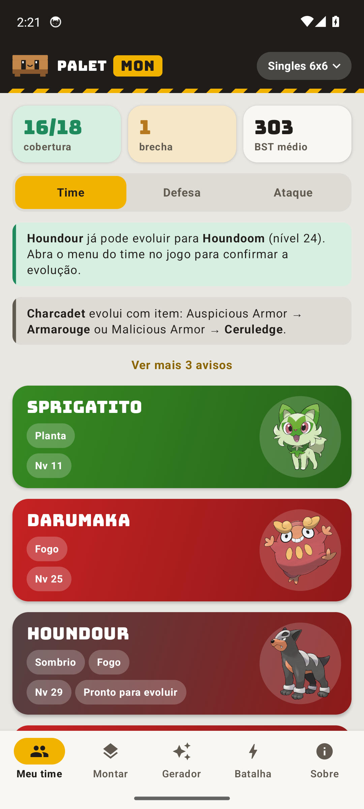

# Palet Mon

Seu time, bem empilhado. Um estrategista de time para o **Cobbleverse**, o modpack de Pokémon para Minecraft.




## Baixar

**[Windows: baixar o instalador](https://github.com/carlosgguilherme/palet-mon/releases/latest/download/Palet-Mon-Instalador.exe)**

Abra o arquivo e pronto. Não precisa de permissão de administrador: o app abre sozinho e cria atalhos na Área de Trabalho e no Menu Iniciar.

O Windows pode mostrar o aviso "O Windows protegeu o computador" porque o instalador ainda não tem certificado digital. Clique em **Mais informações** e depois em **Executar assim mesmo**.

**[Android: baixar o APK](https://github.com/carlosgguilherme/palet-mon/releases/latest/download/Palet-Mon-Android.apk)**

Abra o arquivo no celular. Na primeira vez, o Android pede para permitir a instalação vinda do navegador ou do gerenciador de arquivos.

O código-fonte de cada versão fica separado na página de [releases](https://github.com/carlosgguilherme/palet-mon/releases), em **Source code**.

## Atualizações

Sempre que abre, o app procura uma versão nova no GitHub e pergunta se você quer atualizar. Isso precisa de internet. Para procurar na hora, abra a aba **Sobre** e toque em **Verificar atualizações**. Seu time continua salvo.

As imagens dos Pokémon vêm da PokéAPI: são baixadas na primeira vez e ficam guardadas no aparelho. Sem internet, o app funciona normalmente e mostra as iniciais.

## O que ele faz

- **Meu time:** fraquezas, cobertura de ataque, golpes sugeridos e evoluções.
- **Montar time:** você escolhe seus Pokémon e o app completa o resto em volta deles.
- **Gerador:** times aleatórios, com sinergia, competitivos, de clima, monotipo e mais.
- **Batalha:** quem mandar contra um tipo ou um Pokémon adversário.
- **Modo de combate:** Singles, Duplas, Triplas, 3 de 6, Nv 50, Little Cup e regras personalizadas.

## Para desenvolver

Precisa do [SDK do .NET 8](https://dotnet.microsoft.com/download/dotnet/8.0).

```powershell
dotnet tool restore
dotnet run --project PaletMon
```

- `PaletMon.Core`: dados, lógica e telas do app de PC.
  - `Logic`: tipos, golpes, gerador, modos de combate e fluxo de atualização.
  - `UI`: telas do app de PC.
  - `Assets/dex.json`: dados da PokéAPI.
- `PaletMon`: app de PC, com instalador e atualização pelo Velopack.
- `android`: app nativo de Android, em Kotlin com Jetpack Compose, compilado pelo GitHub Actions. Usa o mesmo `dex.json` e tem o mesmo motor do PC: o teste `ParityTest` compara os dois.
- `PaletMon.Snap`: tira fotos das telas sem abrir janela. Com `--golden <arquivo>`, gera os resultados do motor usados pelo `ParityTest`.

### Lançar uma versão nova

Crie uma tag. O GitHub Actions gera o instalador, o APK, a atualização e a release:

```powershell
git tag v2.3.0
git push origin v2.3.0
```

Quem já tem o app recebe o aviso da versão nova. Para gerar o instalador no seu PC, sem publicar, rode `.\publicar.ps1 -Versao 2.3.0`.

### Chave do Android

O APK precisa ser sempre assinado com a mesma chave, senão quem já tem o app não consegue atualizar. Ela fica na pasta `chaves/`, que não vai para o Git. Guarde uma cópia em lugar seguro.

Depois que o workflow da tag terminar, assine e anexe o APK à release com `.\publicar-android.ps1 -Versao 2.3.0`.

### Assinatura digital

Com um certificado de assinatura de código instalado no Windows, rode `.\publicar.ps1 -Versao 2.3.0 -Certificado <impressão digital>`. Para assinar pelo GitHub Actions, adicione os parâmetros de assinatura ao passo `vpk pack` do workflow.

## Aviso

Palet Mon é um projeto de fã, sem ligação com Nintendo, The Pokémon Company ou Cobblemon. Os dados vêm da [PokéAPI](https://pokeapi.co).
